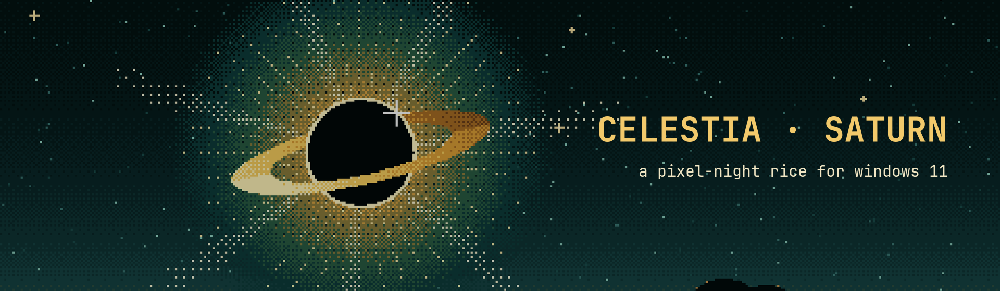
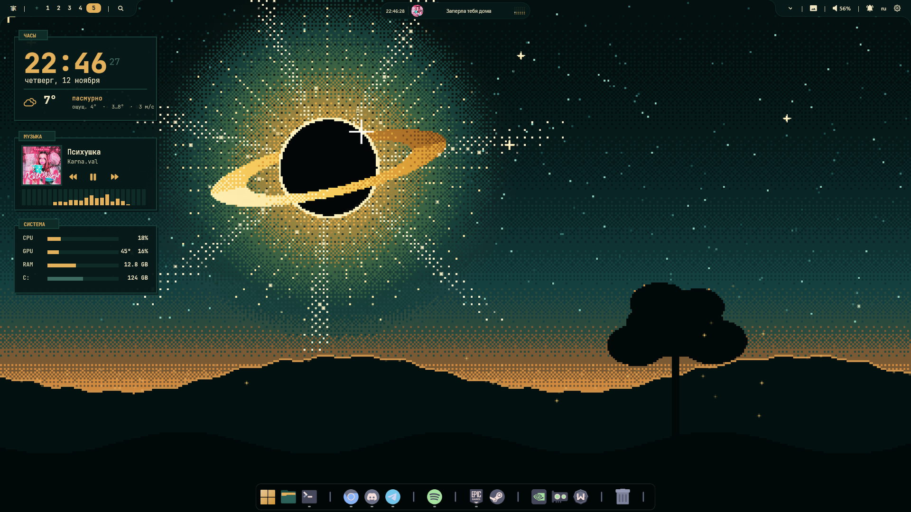
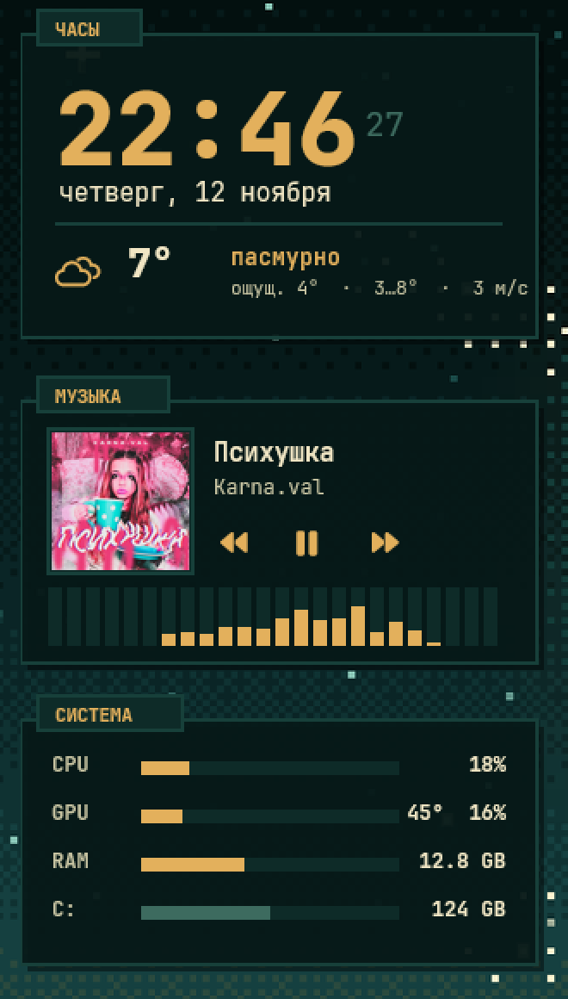
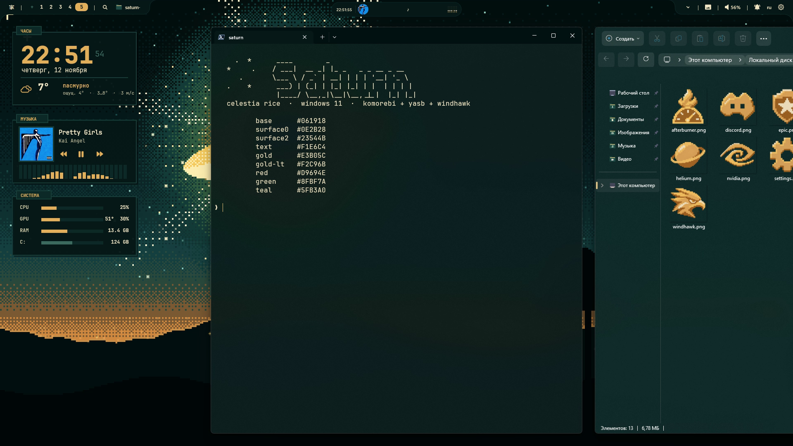

<div align="center">



<br>


**A pixel-night Windows 11 rice: niri-style scrolling tiling, a floating Dynamic Island, a live Saturn eclipse and everything recoloured to match it.**

[Preview video](docs/media/preview.mp4) · [Install](#-install) · [Keys](#-keys) · [What's inside](#-whats-inside) · [По-русски](#-по-русски)

</div>

---

## ✦ Gallery

<table>
<tr>
<td width="50%"><br><sub><b>01</b> live wallpaper · widgets · dynamic island</sub></td>
<td width="50%"><br><sub><b>02</b> new windows slide into scrolling columns</sub></td>
</tr>
<tr>
<td width="50%"><br><sub><b>03</b> focus · <code>Win+R</code> width presets · move column</sub></td>
<td width="50%"><br><sub><b>04</b> dynamic desks: <code>+</code> spawns one, empty ones vanish</sub></td>
</tr>
</table>

<table>
<tr>
<td width="72%"></td>
<td width="28%"></td>
</tr>
</table>



## ✦ Palette

Taken straight from the wallpaper.


## ✦ Features

- **Scrolling tiling like [niri](https://github.com/YaLTeR/niri).** [komorebi](https://github.com/LGUG2Z/komorebi) in Scrolling layout keeps the focused column in the centre while its neighbours peek in from the sides. `Win+R` cycles the width through 1/3, 1/2, 2/3 and full, and every desk remembers its own width.
- **Dynamic desks.** Desk `+` (`Win+0`) always stays empty. Open something there and it moves to a fresh desk at the end. When you leave a desk empty, it closes itself.
- **Focus follows the mouse** ([masir](https://github.com/LGUG2Z/masir)). Pushing the cursor against the screen edge scrolls to the next column.
- **Dynamic Island (Celestia fork).** A Windhawk mod that floats 5 px below the top edge in Saturn colours. It switches to **game mode automatically** when a game is in the foreground, and Caps Lock no longer triggers it.
- **[YASB](https://github.com/amnweb/yasb) bar** with a gap in the middle so the island sits there alone.
- **Rainmeter widgets**:
  - clock with weather from [Open-Meteo](https://open-meteo.com), no API key needed;
  - music with live cover art, working buttons and a visualiser;
  - system stats: CPU, GPU load and temperature, RAM and disk.
- **Live wallpaper** for [Wallpaper Engine](https://store.steampowered.com/app/431960/Wallpaper_Engine/), written in HTML canvas: twinkling stars, a breathing corona, shooting stars and fireflies. The lock screen uses the static image.
- **The whole system follows the palette**:
  - accent and blur, Start menu, taskbar, notification centre, Explorer;
  - folder icons and cursor (recoloured by scripts);
  - Windows Terminal and Spotify (Spicetify).
- **Pixel-art app icons** in gold, in `icons/`.

## ✦ Install

> [!IMPORTANT]
> Read the scripts before you run them. Everything here is plain PowerShell and JSON. Nothing disables Defender, SmartScreen or Windows Update, and no debloat tools are involved.

**1. Clone into your profile.** It has to be this exact path, because the hotkeys point to it:

```powershell
git clone https://github.com/Frostpix11/Saturn "$env:USERPROFILE\Saturn"
cd "$env:USERPROFILE\Saturn"
powershell -ExecutionPolicy Bypass -File .\install.ps1
```

`install.ps1` does the following:
1. Installs the packages from winget: komorebi, whkd, masir, YASB, Rainmeter, Windhawk, PowerToys, Everything, JetBrainsMono Nerd Font and Windows Terminal.
2. Copies the configs. Anything it replaces is saved next to the original as `*.bak-celestia`.
3. Asks for your city for the weather.
4. Applies the accent colour, desktop wallpaper and lock screen.
5. Sets up autostart.

You can skip parts with `-NoPackages`, `-NoWallpaper`, `-NoAccent` or `-NoAutostart`.

**2. Windhawk mods.** Install these from the Windhawk catalogue, then run `windhawk\import-settings.ps1` **as admin**. It loads the Saturn settings for each mod and backs up your current ones first.

| Mod | What it does here |
|---|---|
| [Windows 11 Start Menu Styler](https://windhawk.net/mods/windows-11-start-menu-styler) | Saturn Start menu |
| [Windows 11 Taskbar Styler](https://windhawk.net/mods/windows-11-taskbar-styler) | translucent floating taskbar |
| [Windows 11 Notification Center Styler](https://windhawk.net/mods/windows-11-notification-center-styler) | notification centre colours |
| [Windows 11 File Explorer Styler](https://windhawk.net/mods/windows-11-file-explorer-styler) | Explorer look |
| [Translucent Windows](https://windhawk.net/mods/translucent-windows) | blur and tint for menus and windows |
| [Taskbar Dock Animation](https://windhawk.net/mods/taskbar-dock-animation) | macOS-like icon zoom |
| [Taskbar height and icon size](https://windhawk.net/mods/taskbar-icon-size) | taskbar size |
| [Taskbar auto-hide when maximized](https://windhawk.net/mods/taskbar-auto-hide-when-maximized) | hides the taskbar when a window touches it |
| [Taskbar auto-hide speed](https://windhawk.net/mods/taskbar-auto-hide-speed) | smooth hide and show |
| [Taskbar tray show on hover](https://windhawk.net/mods/taskbar-tray-show-on-hover) | clean tray |
| [Start button colorizer](https://windhawk.net/mods/taskbar-start-button-colorizer) | gold Start button |
| [Resource Redirect](https://windhawk.net/mods/icon-resource-redirect) | folder icon theme (see *Icons* below) |
| [Better file sizes in Explorer details](https://windhawk.net/mods/explorer-details-better-file-sizes) | folder sizes through Everything |
| [Slick Window Arrangement](https://windhawk.net/mods/slick-window-arrangement) | smooth dragging of floating windows |
| [Chrome/Edge scroll tabs with mouse wheel](https://windhawk.net/mods/chrome-wheel-scroll-tabs) | small quality-of-life fix |
| **Dynamic Island (Celestia)** | see below |

<details>
<summary><b>Dynamic Island (Celestia fork)</b></summary>

This is a patched copy of [Dynamic Island for Windows](https://github.com/devcode90/Dynamic-Island-for-Windows) by Himanshu (MIT). The patch is in `windhawk/celestia-auto-game.patch`.

1. In Windhawk, choose **Create a new mod**, paste in `windhawk/dynamic-island-celestia.wh.cpp` and press **Compile**.
2. Run `import-settings.ps1` (admin) to load the Saturn theme and position.

If **Smart App Control** is on, it can block a freshly compiled DLL. Check *Event Viewer → CodeIntegrity → Operational*, event 3077. Recompiling usually produces a build that passes. Don't turn Smart App Control off just for this.

</details>

**3. The rest is manual, a minute each**

- **Rainmeter.** Load `Saturn\Clock`, `Saturn\Music` and `Saturn\System`.
- **Windows Terminal.** Paste `schemes` and `themes` from `terminal/saturn.json` into your `settings.json`.
- **Spotify.** Add `spicetify/color-saturn.ini` to your Spicetify theme, then run `spicetify config color_scheme saturn` and `spicetify apply`.
- **Live wallpaper.** If you have Wallpaper Engine, the installer copies the project into *My Projects → Saturn Eclipse*.
- **Taskbar separators.** Run `taskbar\build-separators.ps1`, start each `sepN.exe --pin` and pin it.
- **Caps Lock as layout switch (optional).** In PowerToys Keyboard Manager, map `Caps Lock → Win+Space` and `Win+Shift+Space → Caps Lock`.

<details>
<summary><b>Icons and cursor (third-party, not included)</b></summary>

- **Folder and system icons.** Get [Catmocha](https://www.deviantart.com/digifeye) by digifeye and extract it to `~\Icons\Catmocha`. `theme\recolor-folders.ps1` turns *Catmocha black* into *Catmocha saturn*. Point Resource Redirect's theme folder at it.
- **Cursor.** Use the Qogir Catppuccin cursors (Windows port by [niivu](https://www.deviantart.com/niivu)). `theme\recolor-cursors.ps1` makes a Saturn version and `theme\apply-cursor-saturn.ps1` applies it.
- **Generic recolour.** `theme\recolor-ico.ps1 -in a.ico -out b.ico -map 'RRGGBB=RRGGBB,...'` works on any icon.

</details>

## ✦ Keys

`Win` is the modifier, niri-style.

| Keys | Action |
|---|---|
| `Win + H / L`, `Win + ← / →` | focus column left / right |
| `Win + J / K`, `Win + ↓ / ↑` | focus window down / up |
| `Win + Ctrl + H / L / J / K` | move window |
| `Win + [` / `Win + ]` | stack into the left / right column |
| `Win + Shift + ]` | unstack |
| `Win + R` / `Win + Alt + R` | width preset next / previous (1/3 · 1/2 · 2/3 · full) |
| `Win + - / =` | width −/+ |
| `Win + 1..9` | go to desk |
| `Win + Ctrl + 1..9` | send window to desk |
| `Win + 0` | clean desk `+` (whatever opens there gets its own new desk) |
| `Win + O` | previous desk |
| `Win + F` / `Win + Shift + F` | maximise / monocle |
| `Win + Alt + Space` | float / tile |
| `Win + Q` | close |
| `Win + T` / `Win + B` | terminal / browser |
| `Win + Alt + L` | lock |
| `Win + Ctrl + Shift + R` | reload komorebi |

Rebind them in `komorebi/whkdrc`.

## ✦ What's inside

```text
Saturn/
├─ install.ps1                one-shot installer (with backups)
├─ komorebi/                  komorebi.json, whkdrc
│  └─ scripts/                start-all, width presets, dynamic desks, edge scroll, shift-windows, restart
├─ yasb/                      bar config + Saturn css
├─ rainmeter/Saturn/          Clock · Music · System skins (UTF-16, keep it)
├─ widgets/media-helper.ps1   now playing, cover art, buttons, GPU and weather for the widgets
├─ windhawk/                  island fork + patch, settings/*.json, import-settings.ps1
├─ theme/                     accent, folder / cursor / icon recolour scripts, Explorer styler theme
├─ terminal/  spicetify/      Saturn schemes
├─ icons/                     pixel-art gold app icons (png + ico) + generator scripts
├─ taskbar/                   separator source + build script
├─ wallpaper/                 saturn-eclipse.png + Wallpaper Engine web project
└─ scripts/restart-shell.ps1  safe Explorer restart (Explorer hangs if komorebi/YASB stay up)
```

<details>
<summary><b>Notes and gotchas</b></summary>

- Restarting `explorer.exe` while komorebi or YASB are running hangs the shell. Use `scripts\restart-shell.ps1` instead.
- `komorebic reload-configuration` only adds rules. To remove one, restart komorebi with `komorebi\scripts\restart-komorebi.ps1`.
- The scrolling layout centres only with an odd number of visible columns. That's why each desk uses one column plus a work-area offset. The offset is computed for your screen width.
- Rainmeter skins must stay **UTF-16 LE with BOM**.
- `start-all.ps1 -boot` opens Discord, Spotify, Steam and Epic **after** the tiling is up, so they land on the right desks. Edit the list to suit you.

</details>

## ✦ Credits

- [rishav12s/windots](https://github.com/rishav12s/windots), the Catppuccin rice this started from
- [devcode90 / Dynamic Island for Windows](https://github.com/devcode90/Dynamic-Island-for-Windows), MIT
- [komorebi, whkd, masir](https://github.com/LGUG2Z) by LGUG2Z · [YASB](https://github.com/amnweb/yasb) · [Windhawk](https://windhawk.net) and its mod authors · [Rainmeter](https://www.rainmeter.net)
- [Catmocha icons](https://www.deviantart.com/digifeye) by digifeye · cursors ported by [niivu](https://www.deviantart.com/niivu), linked only, not redistributed
- Wallpaper: pixel-art Saturn eclipse, original artist unknown. If it's yours, open an issue and I'll credit you or take it down.
- App icons generated for this rice. App logos belong to their owners.

Code and configs are under the [MIT license](LICENSE).

---

## ✦ По-русски

**Celestia · Saturn** это райс Windows 11 в пиксельной ночной теме со скроллинг-тайлингом как в niri и динамическими столами. Сверху парит динамический остров, на фоне живые обои с Сатурном, и вся система перекрашена под них.

**Быстрая установка**

```powershell
git clone https://github.com/Frostpix11/Saturn "$env:USERPROFILE\Saturn"
cd "$env:USERPROFILE\Saturn"
powershell -ExecutionPolicy Bypass -File .\install.ps1
```

Дальше:
1. В Windhawk поставь моды из таблицы выше. Остров ставится через *Create a new mod*: вставь `.wh.cpp` и нажми Compile.
2. Запусти `windhawk\import-settings.ps1` от админа.
3. В Rainmeter загрузи `Saturn\Clock`, `Saturn\Music` и `Saturn\System`.

Всё, что установщик заменяет, он сохраняет рядом как `*.bak-celestia`. Вкл/выкл плавающего окна на `Win+Alt+Space`, ширина колонки на `Win+R`, новый стол на `Win+0`.
